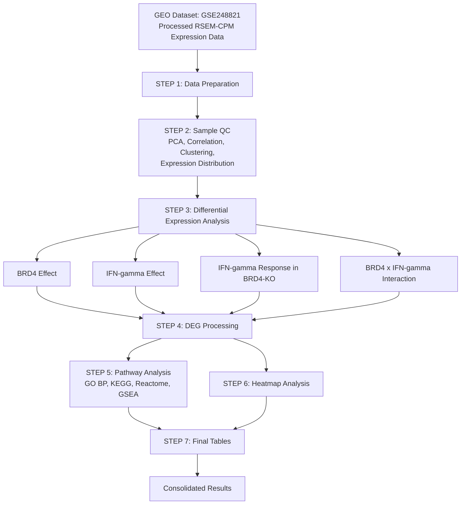

# Transcriptomic Analysis of BRD4-Dependent Interferon-γ Responses in a Colorectal Cancer Organoid Model

**A Nextflow-based RNA-seq data analysis workflow integrating differential gene expression, functional enrichment, and transcriptomic visualization.**

## 1. Project Overview

This project investigates the role of **Bromodomain-containing protein 4 (BRD4)** in regulating Interferon-gamma (IFN-γ)-mediated transcriptional responses in a mouse colorectal cancer organoid model.

Using publicly available RNA-seq data from the Gene Expression Omnibus (GEO), the project examines how BRD4 knockout influences baseline gene expression and cellular responses to IFN-γ treatment.

A factorial differential expression framework was implemented to distinguish the individual effects of BRD4 status and IFN-γ treatment from their interaction.

The complete analysis workflow was organized using **Nextflow**, integrating Python and R scripts for data preparation, quality assessment, differential expression, pathway enrichment, and visualization.

## 2. Research Objectives

- Investigate the transcriptional effects associated with BRD4 knockout.
- Characterize gene expression changes following IFN-γ treatment.
- Evaluate IFN-γ-mediated transcriptional responses in BRD4-knockout organoids.
- Identify genes exhibiting BRD4-dependent responses to IFN-γ.
- Explore biological processes and signaling pathways associated with the observed transcriptional changes.
- Develop an organized and reproducible Nextflow-based analysis workflow.

## 3. Dataset Information

| Parameter | Description |
|---|---|
| Data source | NCBI Gene Expression Omnibus (GEO) |
| GEO accession | GSE248821 |
| Organism | *Mus musculus* |
| Experimental model | Colorectal cancer organoids |
| Data type | RNA-seq |
| Expression data | Processed RSEM-CPM matrix |
| Experimental groups | Four |
| Total samples | 13 |

**Dataset:** [GSE248821 – NCBI GEO](https://www.ncbi.nlm.nih.gov/geo/query/acc.cgi?acc=GSE248821)

### Experimental Design

The dataset contains four experimental groups:

| Experimental group | Sample size |
|---|---:|
| Control | 4 |
| BRD4 Knockout (BRD4 KO) | 3 |
| Control + IFN-γ | 3 |
| BRD4 KO + IFN-γ | 3 |
| **Total** | **13** |

## 4. Computational Workflow

The analysis was implemented as a seven-stage Nextflow workflow.

| Step | Process | Description |
|---|---|---|
| 01 | Data Preparation | Expression matrix preparation, gene annotation and sample metadata processing |
| 02 | Sample QC | PCA, correlation analysis, clustering and expression distribution |
| 03 | Differential Expression | Factorial differential expression analysis using limma |
| 04 | DEG Processing | Identification and classification of differentially expressed genes |
| 05 | Pathway Analysis | GO, KEGG, Reactome and GSEA |
| 06 | Heatmap Analysis | Visualization of top interaction-associated genes |
| 07 | Final Tables | Compilation of differential expression and pathway results |

### Workflow Architecture

The workflow is orchestrated through Nextflow DSL2, with individual Python and R scripts performing the computational analysis.


## Workflow

The analysis was implemented using a modular Nextflow DSL2 workflow.




## 5. Data Preparation and Quality Control

The processed RSEM-CPM expression matrix was used as the input for downstream analysis.

The expression values were log-transformed using:

`log2(CPM + 1)`

Low-expression genes were filtered before differential expression analysis.

**Final analysis matrix: 12,849 genes.**

Sample-level quality assessment included:

- **Principal Component Analysis (PCA):** Examination of sample-level expression patterns and variation.
- **Pearson Correlation Analysis:** Assessment of similarity between samples.
- **Hierarchical Clustering:** Evaluation of sample relationships based on expression profiles.
- **Expression Distribution:** Examination of the distribution of gene expression values across samples.

## 6. Differential Gene Expression Analysis

Differential expression analysis was performed using the **limma framework in R**.

A factorial model was used to investigate the individual and combined effects of BRD4 knockout and IFN-γ treatment.

### Statistical Design

```r
design <- model.matrix(~ BRD4 * IFNg, data = metadata)
```

The factorial design allows assessment of:

- BRD4-associated expression changes.
- IFN-γ-associated expression changes.
- IFN-γ responses under BRD4 knockout conditions.
- Interaction effects between BRD4 status and IFN-γ treatment.

### Four Differential Expression Contrasts

**1. BRD4 Effect**

Identifies transcriptional differences associated with BRD4 knockout relative to the control condition.

**2. IFN-γ Effect**

Identifies transcriptional changes associated with IFN-γ treatment in the control background.

**3. IFN-γ Response in BRD4-KO**

Evaluates the transcriptional response to IFN-γ treatment in BRD4-knockout organoids.

**4. BRD4 × IFN-γ Interaction**

Identifies genes for which the response to IFN-γ differs depending on BRD4 status.

This interaction analysis is particularly important for investigating BRD4-dependent regulation of IFN-γ responses.

### DEG Processing

Differential expression results were processed to identify and organize:

- Significant genes
- Upregulated genes
- Downregulated genes
- Contrast-wise DEG summaries

The applied significance criteria were:

- False Discovery Rate (FDR) < 0.05
- Absolute log2 Fold Change ≥ 1

## 7. Functional Enrichment and Pathway Analysis

Functional enrichment analysis was conducted to investigate the biological significance of differentially expressed genes.

The analysis included four approaches:

| Analysis | Purpose |
|---|---|
| Gene Ontology (GO) Biological Process | Identification of enriched biological processes |
| KEGG | Exploration of enriched biological pathways |
| Reactome | Investigation of curated biological pathways |
| Gene Set Enrichment Analysis (GSEA) | Evaluation of coordinated enrichment patterns across ranked genes |

Pathway analyses were organized separately for all four differential expression contrasts.

### Generated Outputs

- Enrichment result tables in CSV format.
- Pathway enrichment dot plots.
- Contrast-wise pathway summaries.
- GSEA results for GO, KEGG and Reactome.

## 8. Transcriptomic Visualization

The workflow generates multiple visual representations to support interpretation of the analysis.

### Quality Control Visualizations
- PCA plots
- Pearson correlation heatmaps
- Hierarchical clustering plots
- Expression distribution plots

### Differential Expression Visualizations
- Volcano plots for all four contrasts.
- MA plots for all four contrasts.

### Functional and Expression Visualizations
- GO enrichment dot plots.
- KEGG enrichment dot plots.
- Reactome enrichment dot plots.
- GSEA dot plots.
- Top 50 interaction-associated gene heatmap.

## 9. Key Project Outputs

The workflow generates the following major result categories:

| Output directory | Contents |
|---|---|
| `02_Data_Preparation/` | Processed expression matrix, metadata and annotation |
| `03_Sample_QC/` | PCA, correlation, clustering and expression distribution |
| `04_Differential_Expression/` | Results for all four contrasts |
| `05_DEG_Results/` | Significant, upregulated and downregulated gene results |
| `06_Pathway_Analysis/` | GO, KEGG, Reactome and GSEA results |
| `07_Visualizations/` | Heatmap and volcano plot visualizations |
| `08_Final_Tables/` | Consolidated DEG, interaction, pathway and GSEA tables |

## 10. Technology Stack

| Category | Technologies |
|---|---|
| Workflow management | Nextflow DSL2 |
| Programming languages | Python, R |
| Statistical analysis | limma |
| Data processing | pandas, NumPy |
| Visualization | Matplotlib and R visualization packages |
| Biological enrichment | GO, KEGG, Reactome and GSEA |
| Data repository | NCBI GEO |
| Development environment | Linux / Ubuntu |

## 11. Repository Structure

```text
BRD4-IFNg-Transcriptomic-Analysis/
│
├── bin/
│   ├── step1_data_preparation.py
│   ├── step2_sample_qc.py
│   ├── step3_differential_expression.R
│   ├── step4_deg_processing.py
│   ├── step5_pathway_analysis.R
│   ├── step6_heatmap.py
│   └── step7_final_tables.py
│
├── modules/
│   └── data_preparation.nf
│
├── main.nf
├── nextflow.config
├── .gitignore
└── README.md
```

## 12. Reproducibility and Execution

The analysis is orchestrated through Nextflow DSL2.

### Prerequisites

- Nextflow
- Java (compatible with the installed Nextflow version)
- Python 3
- R
- Required Python and R package dependencies

### Input Data

The processed expression dataset is not included in this repository.

Obtain the dataset from [GEO GSE248821](https://www.ncbi.nlm.nih.gov/geo/query/acc.cgi?acc=GSE248821) and place the required input Excel file at the path configured in `nextflow.config`.

### Run the Workflow

```bash
nextflow run main.nf
```

To resume a previous execution:

```bash
nextflow run main.nf -resume
```

**Note:** Verify the configured input path, software dependencies and process execution requirements before running the workflow in a new environment.

## 13. Research Significance

This project demonstrates the application of computational transcriptomics to investigate the relationship between BRD4 and IFN-γ-mediated gene expression in a colorectal cancer organoid model.

By combining factorial differential expression analysis with functional enrichment and pathway-level interpretation, the workflow provides a framework for studying transcriptional changes associated with BRD4 knockout and IFN-γ treatment.

The use of Nextflow further supports organized execution and reproducibility of the computational analysis.

## 14. Project Information

**Project Title:** Transcriptomic Analysis of BRD4-Dependent Interferon-γ Responses in a Colorectal Cancer Organoid Model

**Project Type:** Academic Research Project

**Year:** 2026

**Domain:** Bioinformatics | RNA-seq | Transcriptomics | Differential Gene Expression | Pathway Analysis | Workflow Automation

---

*This repository contains the computational workflow and analysis outputs developed as part of an academic research project.*
